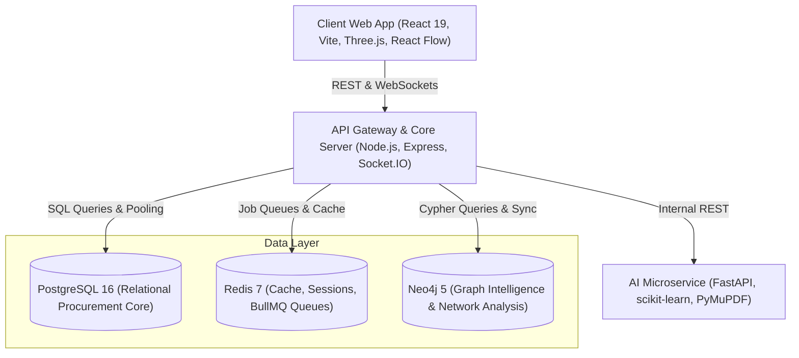
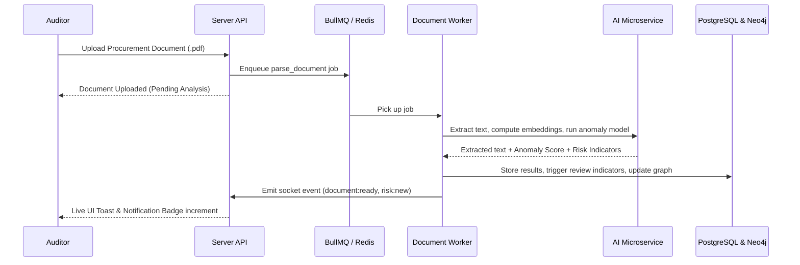

# TenderLens Platform Architecture

## Executive Overview
**TenderLens** is an AI-powered intelligence platform engineered for public procurement auditing, collusion detection, document verification, and fraud prevention. It provides high-ranking oversight bodies, government ombudsmen, and executive investigators with transparent, explainable insights into bidding patterns, company networks, and procedural anomalies.

---

## 1. System Components

### 1.1 Web Client (`client/`)
- **Technology**: React 19, Vite, Lucide Icons, Recharts, Leaflet, React Flow.
- **Visual System**: Executive Obsidian Intelligence Glassmorphism with dual light/dark acrylic themes, 3D tilt interactions, and live reactive counters.
- **Real-time Engine**: Socket.IO client for instantaneous indicator updates, unread counts, and risk status synchronization.

### 1.2 Core Server (`server/`)
- **Technology**: Node.js (ES Modules), Express, BullMQ, pg, neo4j-driver, ioredis.
- **Responsibilities**:
  - Role-based Access Control (RBAC) with granular permissions (`admin`, `auditor`, `analyst`, `viewer`).
  - Multi-factor Authentication (TOTP via QR codes / authenticator apps).
  - Background asynchronous task workers (document parsing, NLP entity extraction, similarity analysis).
  - Graph synchronization pipeline between PostgreSQL entities and Neo4j graph nodes.
  - Audit logging of all critical actions and sensitive access.

### 1.3 AI Intelligence Service (`ai-service/`)
- **Technology**: FastAPI, Python 3.11+, PyMuPDF, scikit-learn, numpy.
- **Key Modules**:
  - **Document Analysis**: Text and metadata extraction from PDF procurement tenders and bid submissions.
  - **Similarity Engine**: TF-IDF vectorization and cosine similarity scoring for bid collusion detection and plagiarism.
  - **Anomaly Detection**: Isolation Forest unsupervised models evaluating pricing anomalies, bidding variance, and outlier timelines.
  - **Entity Extraction**: Regex and NLP heuristic matchers for identifying tax IDs, company registries, and beneficial owners.

---

## 2. Multi-Database Architecture

| Database | Role | Data Held |
| :--- | :--- | :--- |
| **PostgreSQL 16** | System of Record | Users, Roles, Tenders, Companies, Bids, Contracts, Review Indicators, Notes, Audits |
| **Neo4j 5** | Network Intelligence | Company-Tender ownership, joint bidding ties, shared directorship, collusion subgraphs |
| **Redis 7** | Cache & Queue | Session blacklists, rate limits, BullMQ asynchronous workers, Socket.IO channels |

---

## 3. Asynchronous Pipeline & Workers

---

## 4. Security & Compliance
- **Authentication**: JWT access tokens (15m expiry) with httpOnly refresh token rotation and optional TOTP MFA.
- **Sanitization & Validation**: Strict Zod schemas for all inbound payloads.
- **Audit Trails**: Immutable append-only audit logs tracking user IP, user agent, action timestamp, and diff snapshots.
